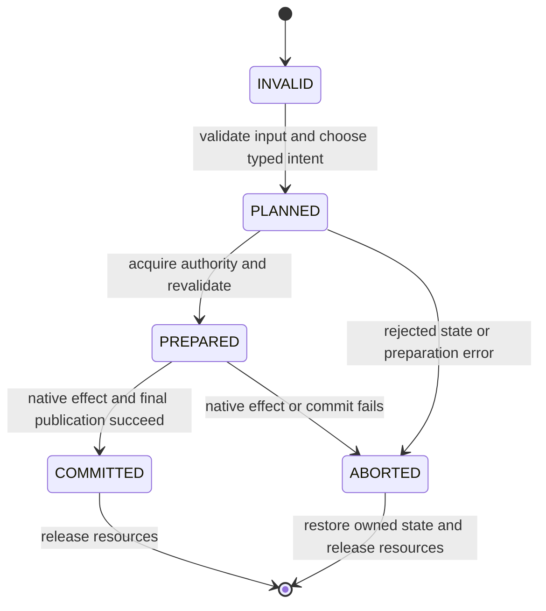
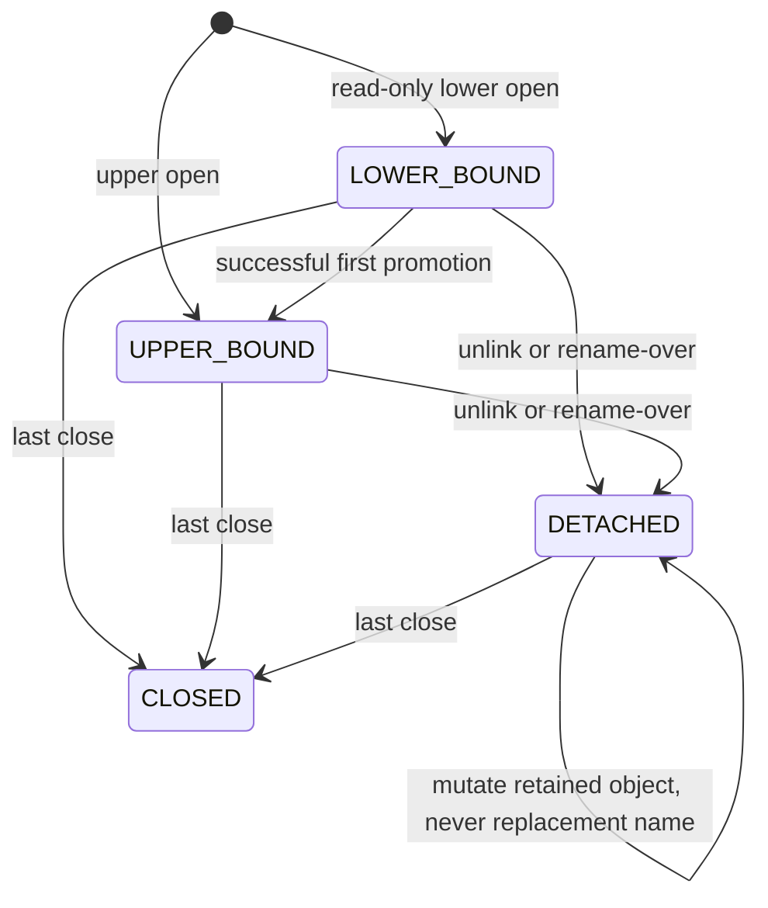
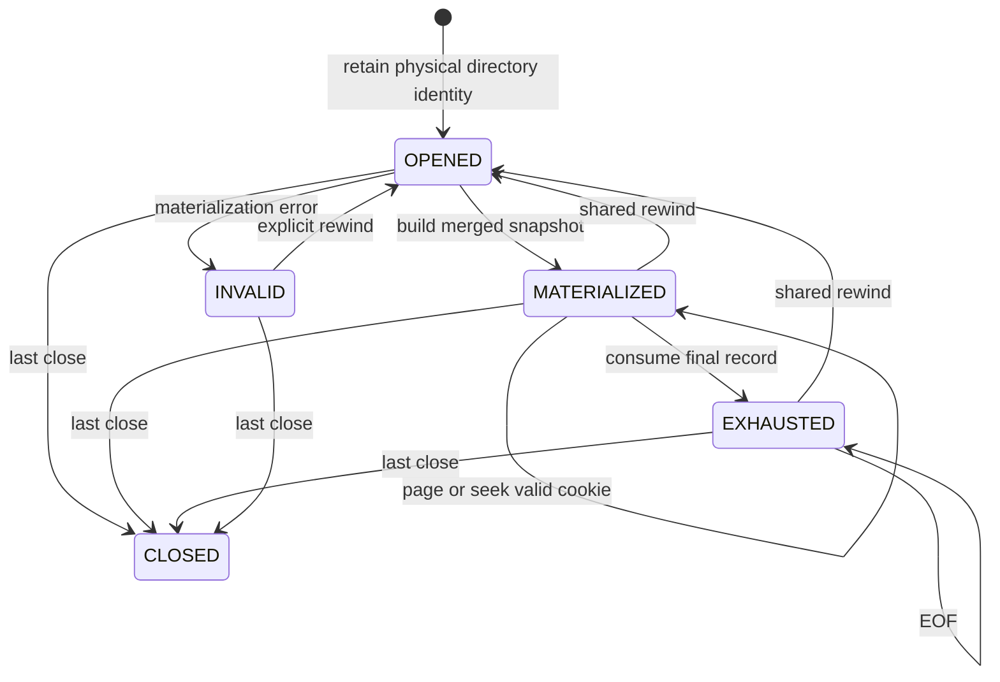
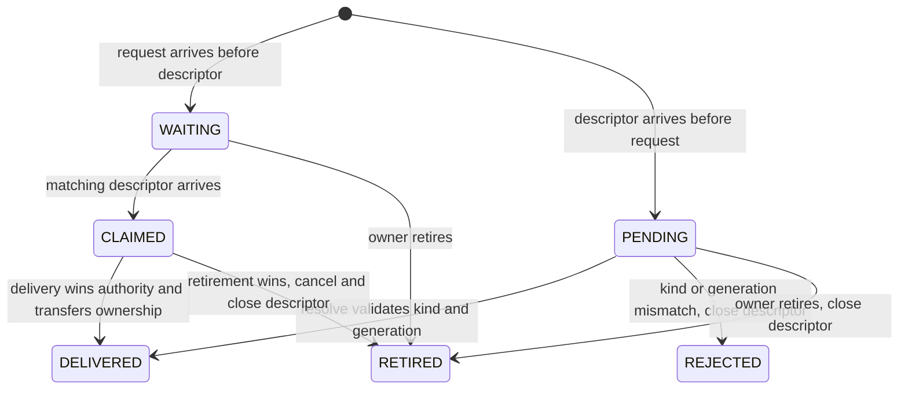
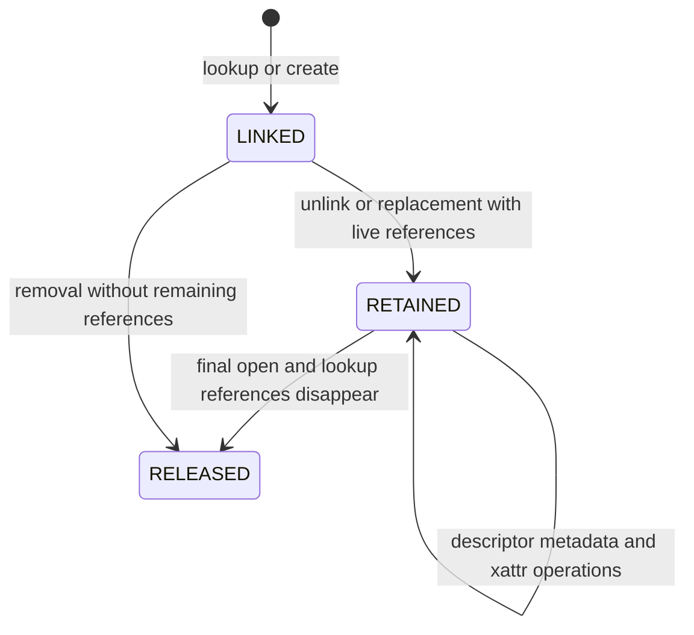

# E-UNION execution and authority

E-UNION is the production union-by-path-translation layer inside Darling's
vchroot. Its lower tree is the selected immutable installation's
`libexec/darling`; its upper tree is the independently owned guest prefix.
The normal stock build enables `DARLING_EUNION`. Ordinary runtime operation
requires neither FUSE nor a Linux overlay mount or user namespace.

Workspace COW lanes may put the **upper prefix** on host `fuse-overlayfs` to
reuse an inert CLT base without copying it. That development backing filesystem
is separate from E-UNION and does not replace its production policy.
Source authority is the canonical West manifest and component Git commits;
select a clean derived source worktree explicitly when the canonical checkout
contains unrelated changes. Historical prototype transcripts are not runbooks.

## One execution layer

Product implementation belongs to XNU's
`darling/src/libsystem_kernel/emulation`, not the workspace test harness:

- `vchroot_userspace.c` retains the existing component-wise resolver and native
  copy/marker effects. Its private `eunion_*.inc` modules own operation,
  namespace, descriptor and directory state.
- `vchroot_expand.h` declares typed visibility, intent, action and phase. A
  mutator plans, prepares native authority, executes its native effect when
  required, then finishes exactly once, including the COMPLETE route.
- Syscall wrappers preserve native argument validation, access modes,
  follow/nofollow policy and results; they do not maintain separate copy-up or
  whiteout policies.
- mldr owns protected native descriptors across dyld and libsystem_kernel.
  Image-local guard tables alone cannot protect shared process resources.

Visibility and operation intent are independent. Visibility distinguishes
absent, whiteout, lower file/directory, upper file/directory, merged directory,
opaque directory and explicit HOST escape. READ_OPEN and single-path CREATE /
CREATE_EXCLUSIVE have an unresolved planning state: resolution occurs only after
shared / exclusive admission respectively. A non-directory visibility class also
covers symlinks and special nodes; native type checks still apply.

Relative bases and parent traversal can leave directory routing unresolved.
Eliding `.` is not permission to return a synthetic upper pathname: the walk
must resolve that effective directory to its visible layer before completing.
Ordinary named components keep the existing component-wise resolution. This
lets libc reopen a lower-only directory with `openat(dirfd, ".")` without
copy-up; HOST paths and real whiteout/missing-path errors retain their policy.

Guest `/` reached through a directory descriptor is the same root as absolute
`/`. Redundant separators and `.` components cannot expose private work storage:
root-base canonicalization precedes component traversal and namespace classification.

## Operation and publication machine

Preparation must never authorize a writable lower path. Read-only lower opens
remain read-only and perform no copy-up. HOST is an explicit unmanaged route,
not a fallback that converts missing guest behavior into success.

Copy-up writes complete data and supported binary xattrs into private staging,
transfers supported metadata, strips setid and `security.capability`, then
publishes with native `renameat2(RENAME_NOREPLACE)`. A concurrent winner is
validated and retained; a loser never overwrites another successful writer.
Failed staging is cleaned without publishing partial data.

Removal validates logical type and emptiness, not just physical upper entries.
Lower names are hidden by regular-file `user.union.whiteout` markers; opaque
upper directories use `user.union.opaque`. These private attributes are hidden
from guest reads/lists and cannot be forged or removed through guest xattr APIs,
including normalized name aliases. Same-inode rename is a revalidated NOOP,
including nonempty same-name directories and distinct hardlink names.

Paired link/rename operands share execution authority. Rollback may restore only
owned staging/markers and must not erase a successful consumer mutation.
Retained parent and inode capabilities, rather than a later pathname reopen,
authorize effects and cleanup. The private work namespace and guest root cannot
be removed or renamed by ordinary managed operations.

## Admission, signals and native resources

A fresh file description of the private namespace lock is acquired per scope:

- **EXCLUSIVE:** reversible copy-up/publication, namespace creation/removal,
  link/rename and first lower-descriptor promotion. Single-path creation holds EX
  before resolving the original spelling through native completion, so competing
  creators see the committed object instead of rejecting a stale missing-path
  snapshot.
- **SHARED:** ordinary upper mutations and new managed open capabilities.
  READ_OPEN holds SH through resolution, native open and descriptor registration,
  so an aborted publication cannot leak a provisional inode to a reader.

Upper mutations can proceed concurrently with each other. Native I/O on already
opened descriptors does not take this pathname admission lock. Bind retains the
ordinary native socket-address spelling and real 107-byte capacity; there is no
proc-fd socket alias broker or changed cwd/temporary-directory contract.

Authority order is Namespace, directory registry, descriptor bindings, then
loader bookkeeping. Nested operations borrow retained authority instead of
recursively flocking a fresh description. Ordinary asynchronous handlers must be
deferred for complete authority lifetimes, not merely the acquisition instruction.
The scope does not newly mask synchronous faults or native real-time signals;
their caller-selected mask bits are preserved. Teardown restores the complete
native mask only after resources are released.

Protected descriptors are adopted/released through mldr's real process-wide
ownership mechanism. Fork quiesces registries before loader preparation; both
branches unlock the inherited namespace description before loader postfork,
then release its retained capability. Process death/exec closes native resources;
this is not a durable multi-operation crash-recovery journal.

## Open descriptions and directory streams

Explicit dup lineages share one open description. Independent opens of the same
inode do not share offsets. Promotion preserves access/status flags, position and
each descriptor's CLOEXEC, and updates known aliases to the same actual upper
OFD. A detached lower object is copied from retained inode authority into private
upper storage; it cannot mutate a replacement at its former name.

Descriptor replacement reserves binding/cursor state before destructive native
work, then publishes native and registry changes under one ordered transition.
A failed dup2 must preserve its existing destination; successful dup2 must not be
overwritten by another descriptor's implicit alias promotion. Directory promotion
must preserve its existing shared stream, not be mistaken for close/reuse.

Directory snapshots use retained physical roots, never an old guest name that
could now identify a replacement. Regular descriptors report ENOTDIR rather
than empty enumeration. dup, dup2 and F_DUPFD preserve shared cursor ownership;
replacement discards the destination's old stream. Short-buffer errors do not
consume entries, and rewind invalidates the shared snapshot for its aliases.

## Courier ownership and retirement

Darlingserver's `FdCourierState` owns descriptor pairing, generation validation
and pending delivery claims. Server connection and process-control transitions
use the same nonrecursive authority, not a second map-only mutex.

Delivery removes its claim under authority before invoking the consumer outside
the lock. Retired callable captures are also destroyed after unlocking; owner
destruction cancels claims even when an arrival object survives it. A consumer
that updates process-control state reacquires authority and revalidates its
identity. Scheduler/fiber work and registry/process/thread operations stay
outside this lock. Delayed process disposal compares the live process identity,
epoch and snapshotted descriptor before retiring a courier incarnation.

Exec retains the Process while replacing its dtape task. Task-disposal callbacks
carry that task's identity: destroying a predecessor cannot retire the current
courier or release the Process keepalive. Current-task identity remains retained
until its final disposal, including when other task references delay destruction.
The callback clears it under the Process lock, then performs transport retirement
and keepalive destruction outside native locks.

## Host lane-provider object lifetime

The external Rust `fuse-overlayfs` provider is a separate host dependency. Its
node ownership is governed by FUSE lookup references and open file/directory
handles, not merely by whether a guest-visible name remains.

Retained objects live in private work storage. The final release removes private
whiteout/opaque sentinels before removing a logically empty retained directory.
Kernel lookup node IDs are independent of exported `st_ino`: lower hardlink
aliases preserve their shared public inode without sharing distinct copy-up
lifetimes. LOOKUP, GETATTR, CREATE and READDIRPLUS retain this distinction through
the explicitly vendored fuser reply API. The exact source revision, immutable
provider build and executable provenance are selected by West; a missing build
fails rather than falling back to a system or Cargo-cache executable.

Recreating a name in upper storage does not erase the lower name it shadows.
Before a provider rename, lower-shadow discovery is bounded by the source
parent's opacity. The source whiteout must be published before success is
acknowledged; publication failure restores native names before publishing the
in-memory move. This is separate from retained-object lifetime and preserves
the recreated object's independent inode identity.

## Verification and limits

The native harness compiles actual production resolver/effect/syscall sources.
Its adapters supply host ABI transport and declarations, not a copied filesystem,
formatter, signal policy or success fallback. TEST scheduling/failure hooks are
absent from shipping code. Permanent oracles observe bytes, xattrs, object
identity, cursor transitions, errors, visibility and resource ownership.

The host compile closure includes `darling-dmg/src/DADeviceProtocol.h` from
the selected complete product tree: vchroot uses its shared device namespace
contract even when the fixture does not activate that namespace. Do not replace
it with fixture-defined device identities. Darwin-only fcntl command numbers
used by the Linux harness come from XNU `bsd/sys/fcntl.h`; Linux still executes
the underlying descriptor operations. NULL-path and guarded-descriptor fixtures
fail immediately if execution reaches their forbidden translation/native-call
boundaries, rather than returning a simulated expected error there.

Guest regressions compile/run through real CLT in Darling and consume optional
`tests-data` from the normal installation. Validate original E-UNION workloads
plus state, routing, xattr and descriptor-lifetime cases. A native harness result
is not deployed-runtime or native macOS evidence. Actual commands, verdicts,
formal skips, warnings and immutable evidence seals belong in the owning Bead.
See [test infrastructure](../../docs/test-infra.md) for selection and lifecycle.

For a libsystem_kernel change publish a fresh complete stock installation,
including matching dyld and mldr, then verify the run's own artifact identity and
normal prefix cleanup. Do not inject replacement runtime copies into test state.

Namespace admission and protected native-FD ownership span processes/images;
virtual alias and cursor registries remain image-private. Quiescent fork has
private cursor snapshots, not universal POSIX cross-process cursor sharing.
Cross-image inherited alias coherence, arbitrary raw-host descriptor operations,
full pathname-read linearizability and crash-atomic namespace recovery are not
certified by these machines. Physical dev/ino may change on copy-up; there is no
synthetic stable-inode virtualization. Explicit host escapes are not a sandbox
against arbitrary host writes to the image.

Overlay semantics were studied from Linux overlayfs documentation, gVisor and
PRoot; they are references, not alternate build/source authorities. Native UAPI
imports and host-only ABI adapters identify their authoritative source beside the
code and retain the component's applicable licensing requirements.
